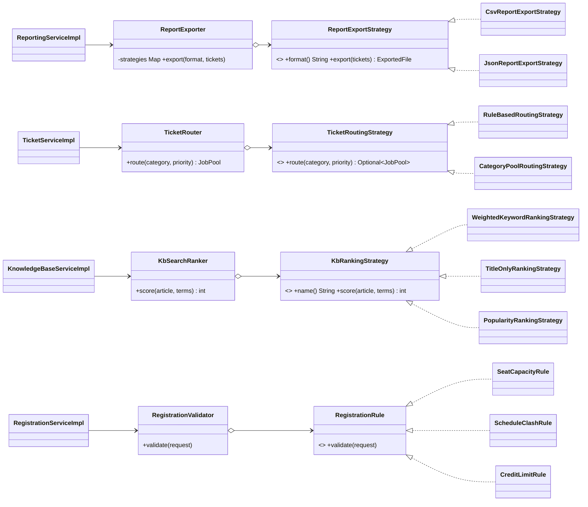

# Strategy Pattern in the University Help Desk

## 1. What is the Strategy pattern?
Strategy is a **behavioral** design pattern. It puts a family of interchangeable algorithms behind one interface so the caller can choose (or swap) the algorithm at run time. It replaces large `if / else` or `switch` blocks with small classes. Observer (already in the project) answers "who must be told?"; Strategy answers "**how** should this be done?".

| Role | Meaning |
|---|---|
| **Strategy** | The interface every algorithm implements |
| **ConcreteStrategy** | One algorithm |
| **Context** | The class that holds / picks the strategies and delegates the work to them |

## 2. Where it is used (4 modules)

| Module | Strategy (interface) | ConcreteStrategies | Context | Problem it solved |
|---|---|---|---|---|
| F5 Reporting | `ReportExportStrategy` | `CsvReportExportStrategy`, `JsonReportExportStrategy` | `ReportExporter` | Export code was hard-wired to CSV inside `ReportingServiceImpl`. A new format meant editing the service. |
| F3 Ticket routing | `TicketRoutingStrategy` | `RuleBasedRoutingStrategy` (admin rules), `CategoryPoolRoutingStrategy` (category default pool) | `TicketRouter` | The routing lookup was copy-pasted in two places in `TicketServiceImpl` (create and re-route). |
| F4 Knowledge Base | `KbRankingStrategy` | `WeightedKeywordRankingStrategy`, `TitleOnlyRankingStrategy`, `PopularityRankingStrategy` | `KbSearchRanker` | Scoring was an inline block in `searchPublished`. Now the ranking is chosen by `app.kb.ranking`. |
| F6 Registration | `RegistrationRule` | `OfferedInSemesterRule`, `CourseAvailabilityRule`, `SeatCapacityRule`, `ScheduleClashRule`, `CreditLimitRule` | `RegistrationValidator` | `submit()` mixed five checks into one long method. Prerequisite checks (a Phase 0 open issue) can now be added as one new class. |

All classes live in `com.helpdesk.strategy.{export, routing, search, registration}`.

## 3. Class diagram (Mermaid)

(`OfferedInSemesterRule` and `CourseAvailabilityRule` also implement `RegistrationRule`; omitted to keep the diagram readable.)

## 4. How it works (example: ticket routing)
1. A student creates a ticket. `TicketServiceImpl.createTicket` calls `ticketRouter.route(category, priority)`.
2. `TicketRouter` (Context) tries each strategy in `@Order`: first `RuleBasedRoutingStrategy`, then `CategoryPoolRoutingStrategy`.
3. The first strategy that returns a pool wins; if none does the ticket stays unrouted.
4. `TicketServiceImpl` never knows which strategy answered.

Spring injects every strategy bean into the Context as a `List`, so **adding a strategy = adding one `@Component` class**. No existing class changes (Open/Closed Principle).

## 5. Benefits and trade-offs
**Benefits:** no long `if/else` chains; each algorithm is small and testable on its own; new behaviour is added without editing tested code; the algorithm can be chosen at run time (`app.kb.ranking`, `/reports/export/{format}`).
**Trade-offs:** more classes; the caller (or config) must know which strategies exist; for a single fixed algorithm Strategy is over-engineering.

## 6. Strategy vs Observer in this project
| | Observer (`TicketEventSubject`) | Strategy (this section) |
|---|---|---|
| Question | Who needs to know a ticket changed? | How should this job be done? |
| Active at once | All observers | One strategy (or the first that answers) |
| Example | Email, audit, notification observers | CSV vs JSON export |

## 7. Demo and configuration
* Standalone demo (no Spring): `docs/design-pattern/StrategyDemo.java`.
* Export: `GET /reports/export/csv` and `GET /reports/export/json` (old `/reports/export.csv` still works).
* Search ranking: add `app.kb.ranking=weighted | title-only | popular` to `application.properties` (default `weighted`, identical to the old behaviour).
